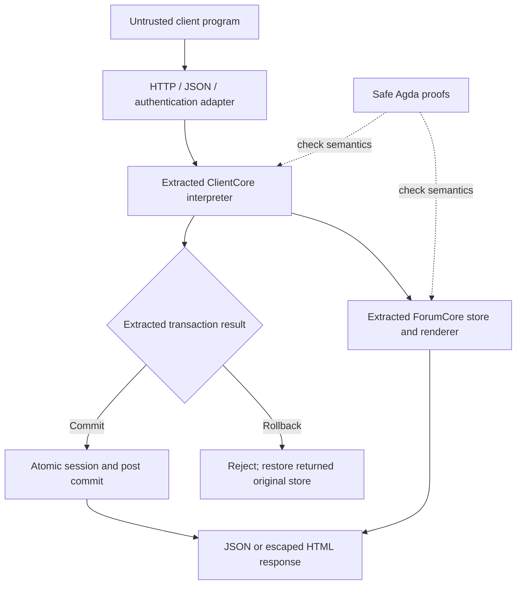

# Trust boundary

Solid arrows are runtime flow. The dotted edges describe proof checking, not a proved compiler-correctness connection. HTTP parsing, credential verification, bearer-to-context binding, commit and private-response routing are Haskell adapters. They are tested, not proved. `generated` is regenerated by agda2hs; no handwritten interpreter is substituted.
