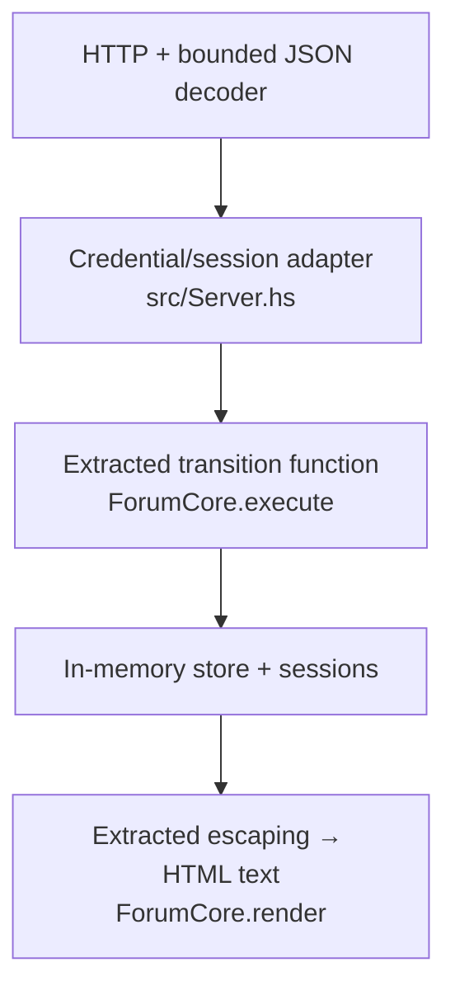
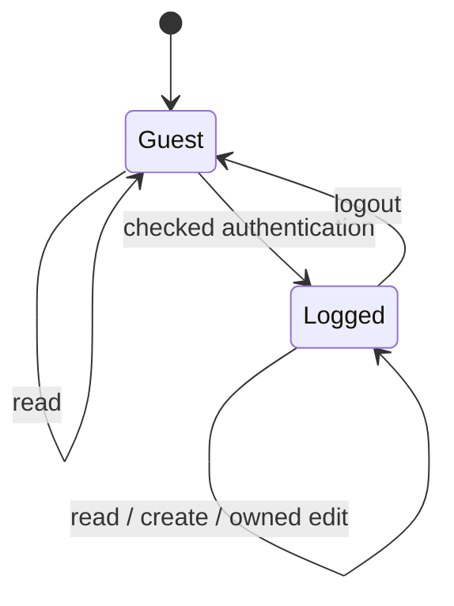

# Architecture and protocol

`execute` and `render` are the proved executable core. HTTP parsing, credentials, session tokens, state storage, ASCII conversion and the browser are outside that proof boundary.

Invalid transitions are rejected. Edit additionally requires an existing owned post and bounded body. Haskell accepts ordinary request ADTs; Agda's indexed `Step` relation certifies every accepted transition.
